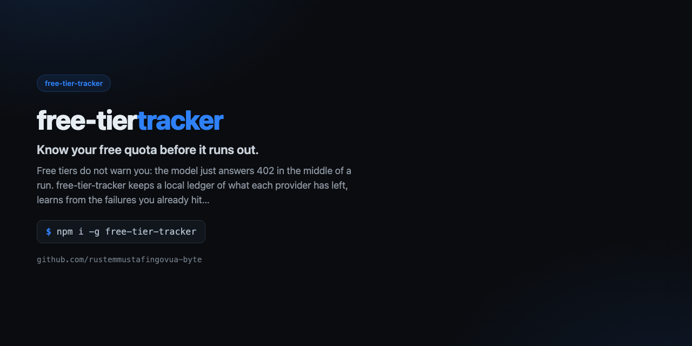

<div align="center">



# free-tier-tracker

**Know your free quota before it runs out.**

[](https://github.com/rustemmustafingovua-byte/free-tier-tracker/actions/workflows/ci.yml)
[](https://www.npmjs.com/package/free-tier-tracker)
[](./LICENSE)
[](https://nodejs.org)
[](https://base.org)

[**Docs**](https://rustemmustafingovua-byte.github.io/free-tier-tracker/) · [Issues](https://github.com/rustemmustafingovua-byte/free-tier-tracker/issues) · [Discussions](https://github.com/rustemmustafingovua-byte/free-tier-tracker/discussions)

</div>

---

Free tiers do not warn you: the model just answers 402 in the middle of a run. free-tier-tracker keeps a local ledger of what each provider has left, learns from the failures you already hit, and tells the agent to stop using a provider that is done for the day.

### v0.2.0 — live quota, not manual notes

The tracker now asks the providers directly instead of waiting for a failure:

```bash
free-tier-tracker refresh   # опросить APInex и BeatAPI
free-tier-tracker status    # показать остаток, rpm и предупреждения
```

| Provider | Source | What we read |
|---|---|---|
| APInex | `GET /v1/balance` | balance, rpm, plan, spent |
| BeatAPI | `GET /v1/usage` | credit balance, spent, tasks |

Keys are read from `APINEX_API_KEY` / `BEATAPI_API_KEY`, or from
`~/.config/opencode/secrets/{apinex,beatapi}.key` if the environment is empty.
No key — no crash: the tracker says it could not reach the provider and keeps the
last known numbers.

## Install

```bash
# tarball из релиза: без токена и без npm-логина
npm i -g https://github.com/rustemmustafingovua-byte/free-tier-tracker/releases/download/v0.1.0/free-tier-tracker-0.1.0.tgz
```

<details>
<summary>Через GitHub Packages (нужен токен со scope read:packages)</summary>

```bash
npm i -g @rustemmustafingovua-byte/free-tier-tracker --registry=https://npm.pkg.github.com
```

</details>
## What it does

| | |
|---|---|
| **A local ledger per provider** | tokens used, failures, exhaustion |
| **Learns from real failures** | recognises 402 / 429 / quota messages |
| **Warnings before exhaustion** | the agent is told which provider to avoid |
| **A pool probe** | watch checks the APInex pool in one request |


## Usage

```bash
free-tier-tracker status
free-tier-tracker note "Free 10M tokens used"
free-tier-tracker watch
```

## CLI

```
free-tier-tracker — Know your free quota before it runs out.

USAGE
  free-tier-tracker status
  free-tier-tracker note "Free 10M tokens used"
  free-tier-tracker spend apinex 12000
  free-tier-tracker reset apinex
  free-tier-tracker watch

COMMANDS / OPTIONS
  status                     what is left of every known free tier
  note <message>             learn a limit failure from a message
  spend <provider> <tokens>  record normal usage
  reset <provider>           clear the exhausted flag
  watch                      probe the APInex pool in one request

State is kept in ~/.config/free-tier-tracker/state.json.

MIT · https://github.com/rustemmustafingovua-byte
```

## Part of a portfolio

| Project | What it does |
|---|---|
| [`opencode-free-stack`](https://github.com/rustemmustafingovua-byte/opencode-free-stack) | route to free models, fall back automatically |
| [`free-web-mcp`](https://github.com/rustemmustafingovua-byte/free-web-mcp) | web search for agents, zero credits |
| [`agent-x402`](https://github.com/rustemmustafingovua-byte/agent-x402) | pay per API call in USDC with a spend policy |

## Donate

MIT, forever. USDC on Base:

```
0x8aC6a229f254980CCd3Dd35CF5E1B7c08880B40E
```

## Support

Every tool here is MIT and free. If it saved you time, you can support the work:

- **USDC (Base):** `0x8aC6a229f254980CCd3Dd35CF5E1B7c08880B40E`
- **GitHub Sponsors:** https://github.com/sponsors/rustemmustafingovua-byte

Paid tiers of the hosted services are billed per call in USDC (x402) — no accounts, no keys.

## License

MIT © rustemmustafingovua-byte

## Dashboard Export (`--export`)

Export the ledger to a single dashboard-friendly JSON file containing one JSON object per UTC day:

```bash
free-tier-tracker --export ./dashboard.json
```

### Export Schema

The exported file is a JSON array sorted by `day` (`YYYY-MM-DD`), with one object per day:

```json
[
  {
    "day": "2026-04-20",
    "totalTokensUsed": 250000,
    "exhaustedCount": 1,
    "providers": [
      {
        "provider": "apinex",
        "live": null,
        "tokensUsed": 250000,
        "dailyTokens": 10000000,
        "left": 9750000,
        "ratio": 0.975,
        "rpm": 10,
        "exhausted": false,
        "kinds": [],
        "warn": false
      }
    ]
  }
]
```
